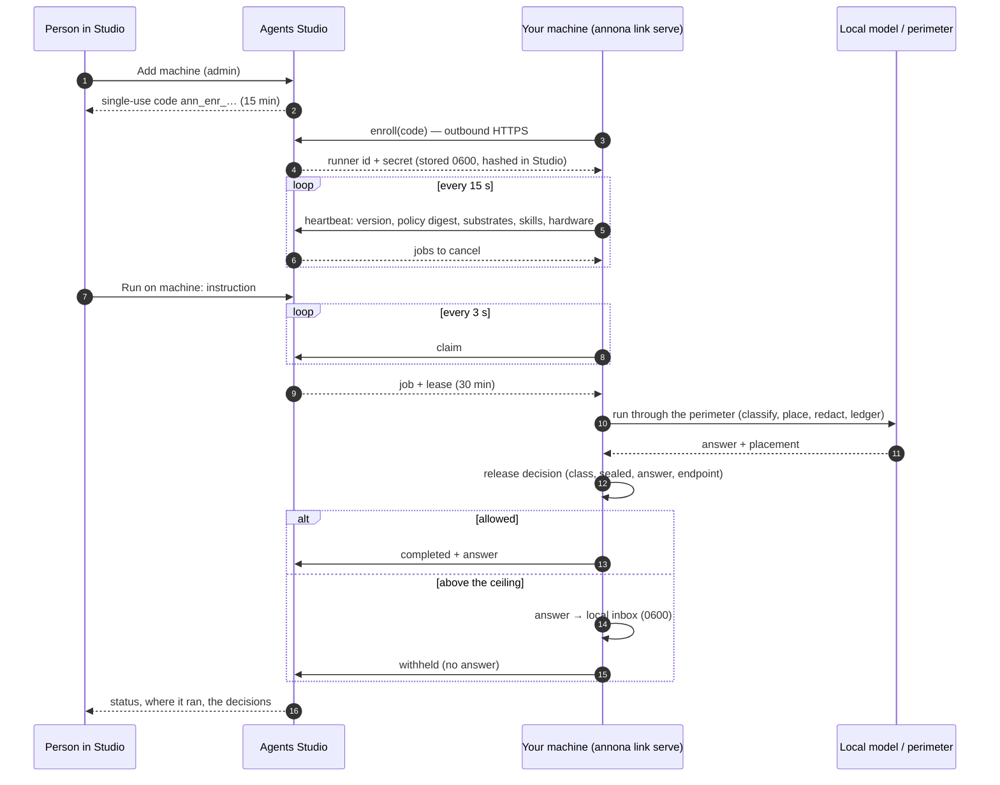

# Link a machine to Agents Studio (optional)

!!! note "Optional, and off until you turn it on"
    Annona is complete without Agents Studio. The CLI, the desktop app, the
    perimeter, the ledger and every local model work the same whether or not a
    machine is linked. **Nothing on the machine talks to Studio until you run
    `annona link enroll`**, and `annona link forget` takes it back to that state.
    If you never link, you can skip this page.

The link lets someone in your organisation send work from
[Agents Studio](https://studio.akaion.com) to a machine you own (a laptop, a
rack server, a DGX Spark, a Ryzen AI Max box) and close the browser while it
runs. The work runs **on that machine, under that machine's policy, on that
machine's models**. Only what the policy allows goes back.

It is a way to **detach work onto local resources** without opening the
machine to the internet: the machine dials out, nothing on it listens, and the
machine's owner, not Studio, decides what an answer may carry. The design and
what it refuses to do are [ADR 0006](../adr/0006-runner-link.md) and
[ADR 0007](../adr/0007-release-bound-to-endpoint.md).


## When to use it, and when not to

| Use the link when… | Don't, when… |
| --- | --- |
| the data must stay on hardware you control, but people want to start work from a browser | one person works on one machine: the CLI or the app is simpler |
| a GPU box sits in a rack and nobody wants to SSH into it to run a question | the machine cannot reach the Studio endpoint over HTTPS |
| several people in an org share one or more local machines | you want Studio to *see* the restricted answers: it won't, by design |

## How it works



Three properties hold throughout:

1. **Outbound only.** The machine opens every connection, over HTTPS. No port,
   no tunnel, no VPN. A firewall that allows outbound 443 to the Studio host is
   enough.
2. **The policy is the machine's.** Studio cannot change it, cannot read files,
   cannot push code and cannot run a tool the policy does not allow. It can send
   an instruction, name a skill the policy already enables, ask for a cancel, ask
   to install a skill the policy pre-approved, and revoke the machine.
3. **The decision to send an answer back is taken on the machine**, after the run,
   with the class the perimeter assigned. A job Studio cannot see the answer to is
   still a job Studio can see *finished*: where it ran and why it stayed.

## Requirements

- Annona installed and **a policy in place** (`annona setup`, see
  [Turning the perimeter on](perimeter.md)). A machine without a usable policy
  refuses remote work and says so.
- A local model the policy can place on (Ollama, for example).
  `annona doctor` should be green before you link.
- Outbound HTTPS to the Studio API. Production is the default; another Studio is
  chosen at enrollment.
- In Studio: an **owner or admin** of the organisation to create the code. Any
  member allowed on the machine can then send work to it.

## 1. Get a code (Studio, owner or admin)

Studio → **Agents** → **Machines** → **Add machine**. Studio shows a single-use
code `ann_enr_…` and the command to paste. The code expires in 15 minutes and
works once. Studio stores only its hash.

You may restrict the machine to some teams of the organisation. Left empty, the
whole organisation can see it and send it work.

## 2. Enroll (on the machine)

```bash
annona link enroll ann_enr_… --name dgx1
```

This:

- exchanges the code for the machine's **own credential** (runner id and
  secret) and writes it to `~/.annona/link.json`, mode `0600`. Studio keeps a
  hash of the secret, never the secret;
- adds a `link` section to the policy if it has none:

```yaml
link:
  release: internal   # the highest class whose ANSWER may go back to Studio
```

Options: `--endpoint https://…` enrolls to another Studio (HTTPS only; the
default is production), `--release public|internal|restricted` sets the ceiling
written when the policy has no `link` section (default `internal`).

Check it with:

```bash
annona link status     # endpoint, runner id, the release ceiling and which rule set it
```

## 3. Serve

Foreground, to watch it:

```bash
annona link serve
```

Within a heartbeat (15 s) the machine shows **Online** in Studio, with the
Annona version, the policy digest, its substrates and models, and the hardware,
for example `NVIDIA GB10 (DGX Spark) · CUDA · unified memory · 128 GB`.

### Detached, as a service

This is the normal way: the machine serves Studio while nobody is logged in.

=== "Linux (systemd)"

    ```ini
    # /etc/systemd/system/annona-link.service
    [Unit]
    Description=Annona link to Agents Studio
    After=network-online.target ollama.service
    Wants=network-online.target

    [Service]
    User=annona
    Environment=ANNONA_HOME=/srv/annona
    ExecStart=/usr/local/bin/annona link serve
    Restart=on-failure
    # Exit code 3 means the credential was revoked in Studio: do not loop on it.
    RestartPreventExitStatus=3

    [Install]
    WantedBy=multi-user.target
    ```

    ```bash
    sudo systemctl enable --now annona-link
    journalctl -u annona-link -f
    ```

=== "Docker Compose (DGX Spark, Ryzen AI Max)"

    Enroll and serve inside the `annona` service, so the link uses the same
    home, policy and Ollama as everything else:

    ```bash
    make up                                          # picks the NVIDIA or AMD overlay
    docker compose exec annona annona link enroll ann_enr_… --name dgx1
    docker compose exec -d annona annona link serve
    ```

    See [Hardware](../reference/hardware.md) for the overlays and the model that
    fits each machine.

=== "macOS (launchd)"

    ```xml
    <!-- ~/Library/LaunchAgents/com.akaion.annona-link.plist -->
    <plist version="1.0"><dict>
      <key>Label</key><string>com.akaion.annona-link</string>
      <key>ProgramArguments</key>
      <array><string>/usr/local/bin/annona</string><string>link</string><string>serve</string></array>
      <key>RunAtLoad</key><true/>
      <key>KeepAlive</key><dict><key>SuccessfulExit</key><false/></dict>
    </dict></plist>
    ```

    ```bash
    launchctl load ~/Library/LaunchAgents/com.akaion.annona-link.plist
    ```

    After a revoke, launchd restarts `serve` and it exits 3 again: unload the
    agent (`launchctl unload …`) when you revoke the machine.

    On a laptop the link works while the lid is open; a sleeping Mac is offline
    in Studio, and jobs wait for it.

## 4. Send work from Studio

On the machine's card, **Run on machine**: an instruction (up to 20,000
characters), optionally a title and a skill. The job is queued for that machine
only; it is claimed within a few seconds if the machine is online, or when it
next comes online.

What Studio shows, and what it means:

| Studio shows | What happened on the machine | What Studio has |
| --- | --- | --- |
| **Queued** | not claimed yet (machine offline or busy) | the instruction |
| **Running** | claimed under a 30-minute lease, running through the perimeter | — |
| **Completed** | the run's class and the answer are within the release ceiling | the answer, where it ran, the decisions with reasons |
| **Kept on machine** (`withheld`) | the run read something above the ceiling, sealed material, or the answer itself classifies above it | that it finished, where it ran, the decisions without reasons; **no answer** |
| **Failed** | the policy held or queued the run (e.g. the local model is down), the skill is not enabled, no policy, or the run raised | the reason: a rule and a substrate, never material |
| **Cancelled** | cancelled from Studio; a queued job never runs, a running one is stopped at the next step | — |
| **Expired** | the lease ran out with no result (machine switched off mid-run) | — |

**Cancel** works in both states: a queued job is cancelled in Studio at once;
a running one is flagged, the machine learns it on the next heartbeat and stops
between steps. The partial run stays in the local ledger.

## What may go back: the release ceiling

The answer goes back only if all of these hold:

- the **class of the run** (the highest class of anything it read) is at most
  `link.release`;
- nothing it read is **sealed** in the policy;
- the **answer itself**, classified like any other text, is at most `link.release`.

Otherwise the job is `withheld`. The ceiling can only be raised for a Studio
you name. A Studio your company runs behind its own firewall can be allowed
more than the public one, and only that Studio:

```yaml
link:
  release: internal            # any Studio
  endpoints:
    - url: https://studio.intranet.example.com
      release: restricted      # this one only
```

The URL must match the endpoint this machine enrolled to (host case and a
trailing slash aside). Any other Studio, for example the same laptop re-enrolled
at home, gets `release`. Sealed material stays on the machine whatever the
endpoint. Issue the internal Studio's certificate from your own CA: the name in
the policy is only as good as the certificate that proves it. Why there are no
wildcards: [ADR 0007](../adr/0007-release-bound-to-endpoint.md).

## Where a withheld answer goes

Into the inbox on this machine, `$ANNONA_HOME/link/inbox/` (mode `0600`):

```bash
annona link inbox          # what stayed here, who asked, why
annona link show 3f2a9c1e  # the instruction and the answer
```

Or open **Inbox** in the desktop app: the same answers, with who asked, why each
one stayed and, one click in, the instruction and the answer. Only the window on
this machine can read it; a web app paired with `annona pair` is refused.

Studio shows the same job as **Kept on machine**, with the command to read it.

## What crosses the wire, exactly

| Call | Machine → Studio | Studio → machine |
| --- | --- | --- |
| `enroll` | the code, the name, the Annona version | runner id, secret, organisation name |
| `heartbeat` (15 s) | Annona version, policy **digest** (not the policy), substrates (id, kind, jurisdiction, max class, model), enabled skills (name, description ≤ 300 chars, whether it pins local; never the text), installable skills, allowed tool names, busy, OS family, **hardware**: os, arch, chip, accelerator, memory a model can use | ids of jobs to cancel |
| `claim` (3 s) | — | one job: id, lease, instruction, title, skill, who asked (email, role, org) |
| `result` | status; placement (class, outcome, substrate); ledger head; decision summary; the answer **only if released** | — |

Never sent: file paths, file contents, the policy text, hostnames, user names,
redaction mappings, the inbox. Studio stores only what the router keeps of the
heartbeat (the hardware fields are cut to five short strings; anything else is
dropped). Studio logs neither secrets, codes, instructions nor answers.

## Skills Studio can name

The heartbeat tells Studio which skills this policy enables (name, description,
whether it pins the run local) and which tools it allows, never a skill's text.
A job may name one; it is loaded before the first turn through the same `skill`
tool a model would call, so the pin and the ledger entry are the same. A name
the policy does not enable fails the job. To offer more, install and enable:

```bash
annona skills-install ~/Downloads/pdf
```
```yaml
skills: [document-triage, case-timeline, pdf]
```

Or let Studio fetch them when they are needed. Name a catalog and the skills you
pre-approve from it; the heartbeat lists those not yet installed, and an admin
in Studio can ask for one, never for anything else:

```yaml
skill_catalogs:
  - name: akaion
    url: https://akaion-ai.github.io/annona/catalog/index.json
    enable: [rfq-triage, eight-d]
```

The archive is verified against the catalog's SHA-256, installed pinned local,
and recorded in the ledger with who asked. See
[Catalogs and installs from Studio](../skills.md#catalogs-and-installs-from-studio).

## The local record

Every job is in the local ledger, hash-chained like every other decision:
`received` with who asked (email, role, organisation), then `released`,
`withheld`, `held`, `queued` or `cancelled` with the reason.

```bash
annona audit           # read it
annona verify          # check the chain
```

The ledger is what to show an auditor: it is on the machine, it names who asked
from Studio, and it cannot be edited without breaking the chain.

## Prove it end to end: `make verify-link`

Before the first real job on a new machine, and after any upgrade, run the
acceptance test against the real Studio. It uses a **throwaway runner in a
temporary home**: your policy, ledger and link are not touched, and the runner
is revoked at the end.

```bash
export ANNONA_STUDIO_TOKEN=…   # a Studio session of an org admin; never printed or written
make verify-link ORG=<organization uuid>
```

| Check | What it proves |
| --- | --- |
| `enroll` | a single-use code from Studio becomes this machine's credential |
| `cancel` | a job cancelled before it is claimed never runs |
| `online` | the heartbeat reaches Studio, with substrates and hardware |
| `released` | an ordinary question runs here and its answer goes back |
| `withheld` | a question carrying a (fictional) codice fiscale runs here; the answer stays in the inbox and Studio never receives it |
| `revoked` | revoking the runner in Studio stops `serve` here |
| `ledger` | every job is in the local ledger and the chain verifies |

Exit code 0 means all seven passed. Options: `--model qwen2.5:7b` (default) or
`--model echo` for the offline scripted model, `--endpoint` for another Studio,
`--keep` to leave the temporary home for inspection. The same script runs in CI
against an in-process Studio that keeps the router's contract
(`tests/test_verify_link.py`), so the protocol cannot drift unnoticed.

## Stop, revoke, forget

- **From Studio:** revoke the machine. Its next request fails and `serve` exits
  with code **3**, whichever of the heartbeat or the poll sees it first. The
  machine stays listed as *Revoked*.
- **From the machine:** `annona link forget` deletes the credential. Revoke it
  in Studio too, so the old secret is dead on both sides.
- **Not linking at all:** don't enroll. No `link.json`, no traffic.

`annona link serve` exit codes: `0` stopped by you, `1` not enrolled or bad
configuration, `3` revoked in Studio.

## Troubleshooting

| Symptom | Likely cause | Check |
| --- | --- | --- |
| `enroll` says the code is invalid | expired (15 min), already used, or another Studio | create a new code; `--endpoint` must match the Studio that issued it |
| Machine stays **Offline** | `serve` not running, or no outbound HTTPS to the Studio host | `annona link status`, `journalctl -u annona-link`, `curl -I` the Studio host |
| Jobs stay **Queued** | machine offline, or busy with a long job: it runs one job at a time | `annona link serve` logs each job it claims; the lease is 30 min |
| **Failed · held by this machine's policy** | the local model is down or the policy has no substrate for that class | `annona doctor` on the machine |
| Everything is **Kept on machine** | the ceiling is lower than the material | `annona link status` shows the ceiling; raise `link.release` deliberately, or read the inbox |
| Answers slow, nothing errors | the model runs on the CPU | `annona doctor` warns `loaded on the CPU, not the GPU`; see [Hardware](../reference/hardware.md) |
| `serve` exits 3 | revoked in Studio | enroll again with a new code if that was not intended |
| No hardware on the card | Annona older than 0.1.4 | upgrade; older runners work, they just don't say |
